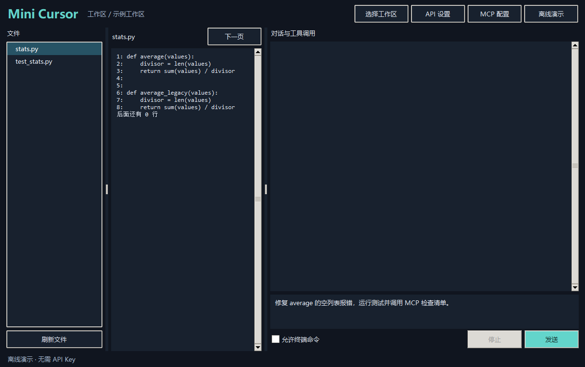
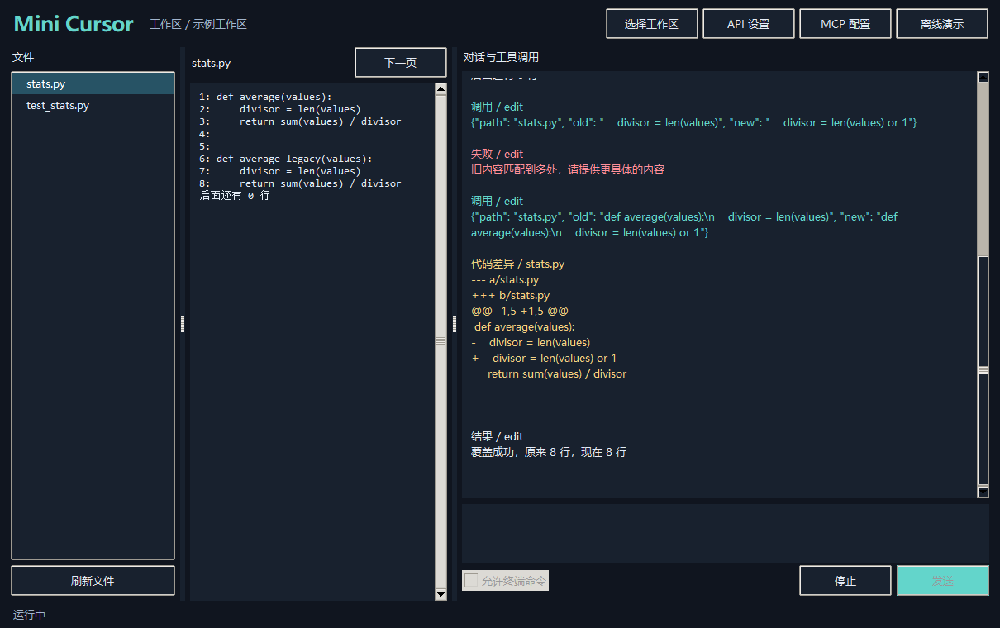
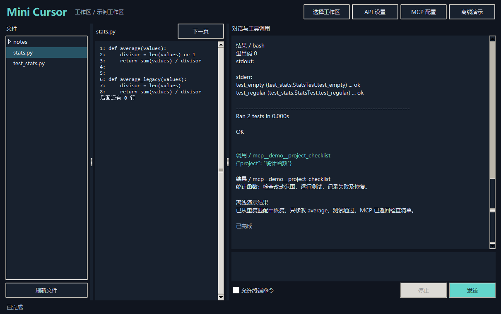

# Mini Cursor · 桌面编程智能体

Windows x64 桌面应用，支持用 DeepSeek 查看项目、修改代码、运行命令并调用 MCP。界面依次展示文件树、代码预览和工具调用。

## 从源码运行

1. 安装 Python 3.11 或更新版本，进入仓库目录。
2. 在 PowerShell 运行 `python app.py`，然后选择工作区。
3. 点击「API 设置」输入自己的 DeepSeek API Key，再发送任务。「离线演示」使用独立样例目录，可直接体验。

Windows 安装版从 GitHub Release 下载 `MiniCursor-Setup-1.3.0-x64.exe`。安装后从开始菜单打开 **Mini Cursor**。Key 也可通过启动进程的 `DEEPSEEK_API_KEY` 环境变量提供。

## 演示与截图

- [v1.3 安装版演示视频](demo.mp4)（4 分 25 秒，中文字幕）
- 00:08 代码修复、单元测试与 MCP 实录
- 00:27 技能目录与启用前后对照
- 01:43 项目规则、拦截、自动测试与只读审查
- 03:41 强制结束后续跑与完成通知

A、B 环节取自离线验收的实际工具输出，使用受控模型替身。

离线演示按固定步骤执行真实工具。日常模式使用 DeepSeek 自主选择工具。使用自己的项目时，勾选「允许终端命令」才可执行 Bash 或 PowerShell 命令，命令使用当前用户的系统权限。

## 仓库结构

| 文件 | 职责 |
| --- | --- |
| `app.py` | 三栏界面、设置、停止 |
| `agent_core.py` | 模型请求、工具循环、可见事件 |
| `agent_tools.py` | 文件读取、原子写入、精确替换 |
| `shell_runner.py` | 带超时和输出截断的命令执行 |
| `mcp_client.py`、`demo_mcp.py`、`mcp.json` | MCP 客户端、独立演示服务和配置示例 |
| `server.py` | 可独立运行的本机 SSE 后端 |
| `build.ps1`、`installer.py`、`requirements-build.txt` | 打包和安装 |
| `hello_deepseek.py` | 初期终端问答示例，使用 OpenAI Python 客户端 |

其他资料见 [运行记录](docs/trace.md)、[打包说明](docs/build.md) 和 [项目报告](report.md)。

## v1.1 技能系统

包括课件指定的纯提示词测试、脚本审查 Git 差异和 MCP 读取 GitHub Issue，也保留 CSV 检查及项目清单。使用方法、开关与报告生成方式见 [技能说明](docs/skills.md)，本次验收结果见 [skill_report.json](skill_report.json)。

## v1.2 定制层

项目规则、三条 Hook 和只读审查见 [操作说明](docs/customization.md) 和 [自动验收报告](custom_report.json)。

## v1.3 断点续跑

点击「续跑检查」运行可恢复的工作区检查。每步保存进度，完成后弹出系统消息。复验方式见 [断点续跑说明](docs/daemon.md)。
